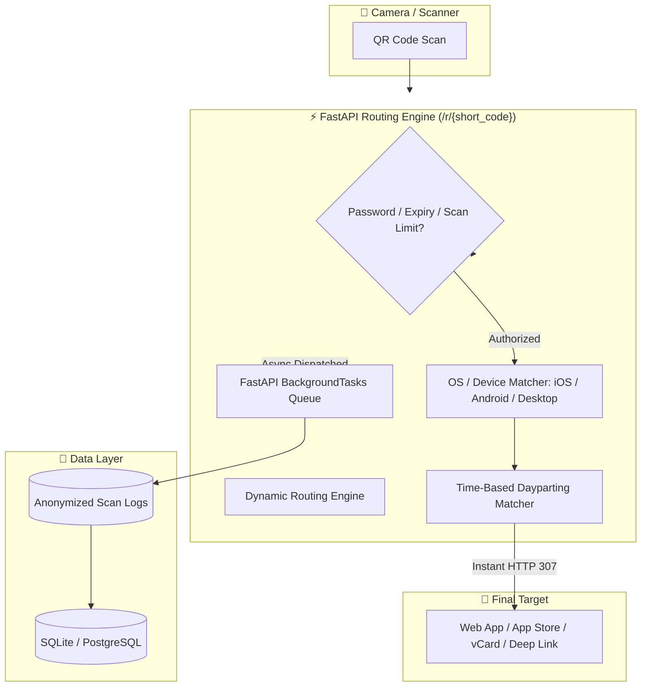

# ⚡ SmartQR — Dynamic QR Studio & Telemetry Management Platform

[](https://nextjs.org/)
[](https://tailwindcss.com/)
[](https://ui.shadcn.com/)
[](https://www.framer.com/motion/)
[](https://www.python.org/)
[](https://fastapi.tiangolo.com/)
[](LICENSE)

> **Enterprise-grade, unrestricted dynamic QR code generator and smart telemetry routing platform.**  
> Built with high-performance Python FastAPI engine and a modern, human-crafted Next.js frontend (Tailwind CSS, Shadcn/Radix UI, Framer Motion, Lucide Icons).

---

## 📖 Table of Contents

- [Overview](#-overview)
- [Why SmartQR? (Core Value Proposition)](#-why-smartqr-core-value-proposition)
- [System Architecture & Core Modules](#-system-architecture--core-modules)
  - [Module A: Visual Customization Studio](#module-a-visual-customization-studio)
  - [Module B: Real-Time Scannability Guard](#module-b-real-time-scannability-guard)
  - [Module C: Dynamic QR & Smart Routing Engine](#module-c-dynamic-qr--smart-routing-engine)
  - [Module D: Multi-Payload Generators](#module-d-multi-payload-generators)
  - [Module E: Business Workspace & Telemetry Analytics](#module-e-business-workspace--telemetry-analytics)
- [Tech Stack](#-tech-stack)
- [Project Structure](#-project-structure)
- [Getting Started & Local Installation](#-getting-started--local-installation)
  - [Prerequisites](#prerequisites)
  - [Step-by-Step Installation](#step-by-step-installation)
  - [Running the Application](#running-the-application)
- [API Reference](#-api-reference)
- [Related Documentation](#-related-documentation)
- [License](#-license)

---

## 🌟 Overview

**SmartQR** is a full-featured, developer-friendly, and enterprise-ready platform designed to generate, customize, manage, and analyze dynamic QR codes. 

Most commercial QR providers gate essential features behind costly recurring subscriptions, suddenly disable printed codes when free trials expire, restrict vector exports (SVG/PDF), and route scans through sluggish intermediate ad pages.

SmartQR provides a **100% free, permanent, privacy-focused, and ultra-fast** alternative. Print your codes once, change destinations anytime, and retain full control over your routing, brand identity, and telemetry data.

---

## 💎 Why SmartQR? (Core Value Proposition)

| Feature | Standard Commercial Services | SmartQR Platform |
|:---|:---|:---|
| **Dynamic QR Expiration** | Hidden 7–14 day trial paywalls; codes stop working | **Permanent, lifetime-editable dynamic short-links** |
| **Vector Exports (Print/Billboard)** | Paid tier lock; low-res watermarked PNGs | **Unrestricted SVG, High-Res PNG (up to 4K), and PDF** |
| **Redirection Speed** | 300ms–1500ms (slow ad trackers, interstitials) | **Sub-50ms zero-latency async HTTP 307 redirection** |
| **Styling Capabilities** | Basic squares, rigid templates | **Granular patterns, custom eye geometries, and frames** |
| **Scannability Assurance** | None; trial-and-error by user | **Live WCAG contrast calculation & readiness score** |
| **Analytics Privacy** | Third-party ad tracking, invasive cookies | **Privacy-safe daily salted IP hashing & GeoIP telemetry** |

---

## 🧩 System Architecture & Core Modules



### Module A: Visual Customization Studio
- **Granular Pattern Control**: Choose data module shapes—*Square*, *Rounded*, *Dots / Circle*, *Classy (Diamond)*, and *Liquid (Organic)*.
- **Finder Patterns (Eyes)**: Customize outer frame geometry (*Square, Rounded, Circle, Leaf*) and inner ball shape (*Square, Circle, Diamond, Leaf*) with independent color tinting.
- **Advanced Color & Gradients**: Solid colors, multi-angle linear gradients, radial glow gradients, and transparent backgrounds (`RGBA`).
- **Smart Logo Placement**: Center logo upload (PNG, JPG, SVG) with automatic padding and safe data module clearance to prevent occlusion.
- **Pre-Built CTA Frames**: Decorative outer frames with custom call-to-action badges (*"Scan for Menu"*, *"Scan Me"*, *"Connect Wi-Fi"*).
- **Brand Kit Presets**: Save and load corporate themes and color palettes with 1-click presets.

### Module B: Real-Time Scannability Guard
- **Live WCAG Contrast Checker**: Photometric relative luminance check alerting if foreground-to-background contrast falls below 4.0:1.
- **Auto Error-Correction Adjustment**: Automatically escalates error recovery to Level `H` (30% redundancy) when center logos or dense payloads are detected.
- **Live Scannability Score**: Interactive visual readiness meter (0–100%) indicating camera scannability confidence before printing.

### Module C: Dynamic QR & Smart Routing Engine
- **Editable Short-Links**: Cryptographically secure short slugs (`/r/{short_code}`) that can be redirected to any destination at any time without reprinting.
- **Device & OS Routing**: Route scans dynamically based on the client OS (iOS $\rightarrow$ App Store, Android $\rightarrow$ Google Play Store, Desktop $\rightarrow$ Web Homepage).
- **Time-Based Scheduling & Dayparting**: Serve different destinations depending on the hour of the day (e.g., Breakfast vs. Dinner Menu) or active campaign date windows.
- **Security & Access Control**: Password/PIN protection screen, maximum scan limits, and hard expiration dates.

### Module D: Multi-Payload Generators
- **vCard Plus**: Dynamic digital business card profile with contact details, social links, and a 1-click `.vcf` file download.
- **Direct Wi-Fi Connect**: Standard WPA/WPA2/WPA3 configuration strings for instant camera network connection.
- **Pre-filled Action Triggers**: WhatsApp chat templates (`wa.me`), pre-filled emails (`mailto:`), SMS, and Google Maps coordinates.
- **App Deep-Linking**: Support for native application URI schemes (Instagram, Facebook, bKash, UPI) with graceful web fallbacks.

### Module E: Business Workspace & Telemetry Analytics
- **Zero-Latency Async Tracking**: Scan events are captured via background workers without slowing down the client redirect response.
- **Audience Insights Dashboard**: Interactive metrics for unique vs. total scans, hourly scan heatmaps, device breakdowns, and geographic origin.
- **Bulk QR Generation (CSV Upload)**: Upload a CSV containing up to 500 URLs/labels, apply current visual styling, and download a bundled `.zip` archive.
- **Folder & Campaign Organization**: Manage QR codes by workspace, client, project folder, and custom tags.

---

## 🛠️ Tech Stack

### Frontend (Next.js Modern Architecture)
- **Framework**: [Next.js 14+](https://nextjs.org/) (App Router, Server & Client Components)
- **Styling**: [Tailwind CSS](https://tailwindcss.com/) with a refined dark-luxe slate palette & micro-grid backgrounds
- **Component Primitives**: [Shadcn UI](https://ui.shadcn.com/) / [Radix UI](https://www.radix-ui.com/) (Accessible Dialogs, Sliders, Tabs, Tooltips, Accordions)
- **Icons**: [Lucide React](https://lucide.dev/) (ultra-clean, modern vector icons)
- **Animations**: [Framer Motion](https://www.framer.com/motion/) (smooth spring transitions, reactive meter animations)
- **State Management**: [Zustand](https://zustand-demo.pmnd.rs/) (reactive studio designer state)
- **Data Fetching**: [TanStack React Query](https://tanstack.com/query) (real-time caching & optimistic updates)
- **Charts & Telemetry**: [Recharts](https://recharts.org/) (responsive SVG device/OS breakdown charts)
- **Color Engine**: [Colord](https://colord.omgovich.ru/) (WCAG 2.1 photometric contrast calculations)
- **Notifications**: [Sonner](https://sonner.emilkowal.ski/) (modern stacked toast notifications)

### Backend (Python Core Engine)
- **API Framework**: [FastAPI](https://fastapi.tiangolo.com/) with [Uvicorn](https://www.uvicorn.org/) (ASGI server)
- **Rendering Engine**: [Pillow](https://python-pillow.org/) & [qrcode (styledpil)](https://github.com/lincolnloop/python-qrcode)
- **Database**: SQLite (local default) / PostgreSQL compatible
- **Background Tasks**: FastAPI native `BackgroundTasks` for zero-latency telemetry logging

---

## 📁 Project Structure

```
SmartQR-Management/
├── backend/                  # FastAPI Core Engine
│   ├── app.py                # REST API, routing rules, redirects, export endpoints
│   ├── database.py           # SQLite connection, CRUD, anonymized salted telemetry
│   ├── models.py             # Pydantic schemas and data validation
│   └── qr_service.py         # Pillow & styledpil rendering (SVG, PNG, 300 DPI PDF)
├── frontend-next/            # Next.js Modern Frontend Application
│   ├── app/                  # App Router (layout, page, /r/[code], /v/[code])
│   ├── components/
│   │   ├── studio/           # Pattern, Eye, Color, Logo, Frame & Security controls
│   │   ├── preview/          # Live Hologram Preview, Scannability Guard, Exports
│   │   ├── manager/          # QR Grid, search toolbar, folder navigation
│   │   ├── modals/           # Rules modal, URL editor, Analytics, Brand Kit
│   │   └── ui/               # Shadcn/Radix accessible UI components
│   ├── hooks/                # Zustand QR studio store & scannability hooks
│   ├── lib/                  # Backend API client & color helpers
│   ├── tailwind.config.js    # Refined slate design tokens & animations
│   └── package.json          # Next.js dependencies (Lucide, Framer Motion, Radix)
├── frontend/                 # Standalone static preview distribution
├── data/
│   └── smartqr.db            # SQLite database (auto-migrated)
├── main.py                   # FastAPI server launcher
├── docs/
│   ├── FEATURE.md            # Comprehensive feature specifications
│   └── TASK.md               # Phased engineering roadmap & tracking
├── requirements.txt          # Python dependencies
└── README.md                 # Project documentation
```

---

## 🚀 Getting Started & Local Installation

### Prerequisites

Ensure you have the following installed on your system:
- **Python**: Version `3.10` or higher
- **pip**: Python package manager
- **Git** (optional, for cloning)

### Step-by-Step Installation

1. **Clone or Navigate to the Project Directory**:
   ```bash
   cd c:\Project\test_projects\SmartQR-Management
   ```

2. **Create and Activate a Virtual Environment** (Recommended):
   - **Windows (PowerShell)**:
     ```powershell
     python -m venv venv
     .\venv\Scripts\Activate.ps1
     ```
   - **Linux / macOS**:
     ```bash
     python3 -m venv venv
     source venv/bin/activate
     ```

3. **Install Dependencies**:
   ```bash
   pip install -r requirements.txt
   ```

### Running the Application

1. **Start the Server**:
   You can run the launcher script:
   ```bash
   python main.py
   ```
   Or run directly with Uvicorn with auto-reload:
   ```bash
   uvicorn backend.app:app --host 0.0.0.0 --port 8000 --reload
   ```

2. **Open the Application**:
   - **Web UI**: Open [http://localhost:8000](http://localhost:8000) in your browser.
   - **Interactive API Documentation (Swagger)**: [http://localhost:8000/docs](http://localhost:8000/docs)
   - **Alternative API Reference (ReDoc)**: [http://localhost:8000/redoc](http://localhost:8000/redoc)

---

## 📡 API Reference

| Method | Endpoint | Description |
|:---|:---|:---|
| `POST` | `/api/qr/preview` | Generates a live, customized QR preview image (in-memory, no DB write). |
| `POST` | `/api/qr` | Persists a new Dynamic or Static QR code and returns its details. |
| `GET` | `/api/qr` | Lists all QR codes with optional search query and type filters. |
| `GET` | `/api/qr/{id}` | Fetches details and metadata for a specific QR code. |
| `PUT` | `/api/qr/{id}` | Updates destination URL, title, or styling for an existing QR code. |
| `DELETE` | `/api/qr/{id}` | Deletes a QR code and its associated scan audit records. |
| `GET` | `/api/qr/{id}/download/{fmt}` | Downloads the QR code in `png` or `svg` (and `pdf`). |
| `GET` | `/api/qr/{id}/image` | Direct PNG endpoint used for thumbnail rendering in dashboard cards. |
| `GET` | `/api/qr/{id}/analytics` | Retrieves scan count, device breakdown, and recent audit logs. |
| `GET` | `/api/stats` | Aggregated metrics for the dashboard banner (total scans, active QRs). |
| `GET` | `/r/{short_code}` | **Core Dynamic Redirect**: Evaluates rules, logs scan asynchronously, and redirects with `HTTP 307`. |

---

## 📚 Related Documentation

For in-depth technical details and development tracking, refer to:
- 📑 **[FEATURE.md](file:///c:/Project/test_projects/SmartQR-Management/FEATURE.md)** — Comprehensive architectural specification covering all mathematical models, WCAG contrast formulas, and schema designs.
- 📋 **[TASK.md](file:///c:/Project/test_projects/SmartQR-Management/TASK.md)** — Actionable, phased engineering task breakdown with acceptance criteria and status tracking.

---

## 📄 License

This project is licensed under the **MIT License**. You are free to modify, distribute, and self-host this platform for personal or commercial use.
