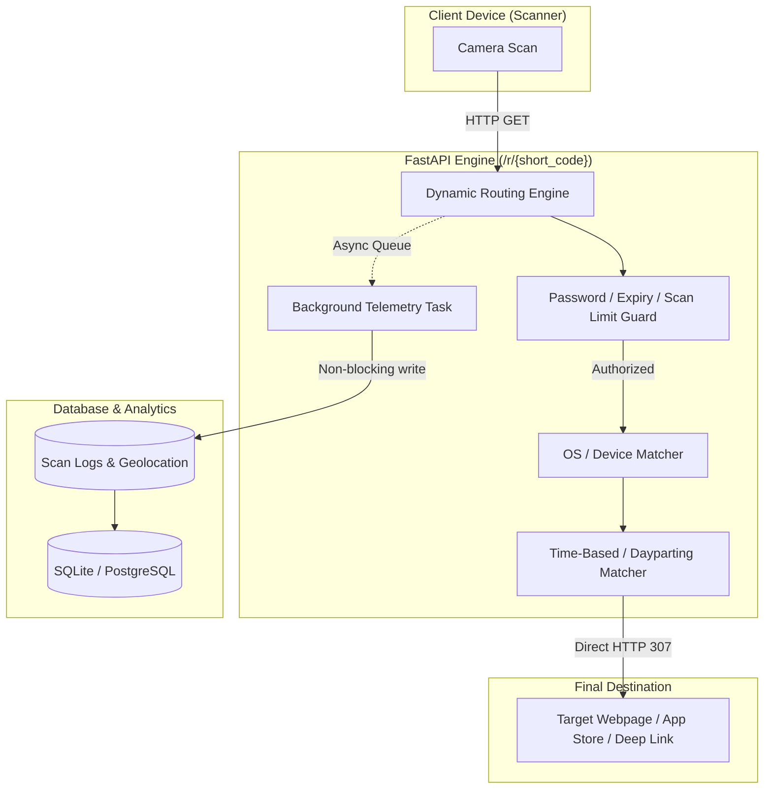
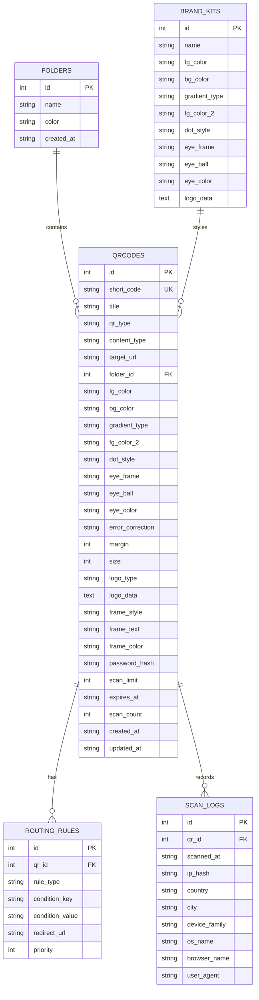

# 🌟 SmartQR Platform — Comprehensive Feature Specification (FEATURE.md)

> **Document Version:** 2.1.0  
> **Last Updated:** October 2026  
> **Status:** Approved Architecture & Specification  
> **System Architecture:** Python FastAPI Micro-Engine Backend + Next.js (App Router, Tailwind CSS, Shadcn/Radix UI, Framer Motion) + SQLite/PostgreSQL Database

---

## 📌 Executive Summary & Core Value Proposition

The **SmartQR Management Platform** is engineered to eliminate the predatory subscription models and feature-gating prevalent in commercial QR services (e.g., QR Code Generator, Bitly, Beaconstac). Commercial competitors routinely disable printed dynamic QR codes behind sudden paywalls or trial expirations, restrict vector/print-grade exports to premium tiers, and insert sluggish intermediate tracking redirects filled with ads or tracking cookies.

SmartQR delivers an enterprise-grade, open, ultra-fast dynamic QR generation and telemetry ecosystem built on three foundational pillars:

```
┌─────────────────────────────────────────────────────────────────────────────┐
│                       SMARTQR CORE VALUE PROPOSITION                        │
├───────────────────────────────┬─────────────────────────────┬───────────────┤
│    TRUE FREE DYNAMIC QRS      │ UNRESTRICTED VECTOR EXPORTS │ ZERO-LATENCY  │
│ Lifetime editable short-links │ Ready for billboard & print │ Sub-50ms fast │
│   No trial or forced expiry   │   SVG, High-Res PNG, PDF    │ async routing │
└───────────────────────────────┴─────────────────────────────┴───────────────┘
```

1. **True Free Dynamic QRs**: QR codes printed on physical packaging, business cards, jerseys, or billboards can have their destination URL updated at any time from the dashboard—forever, with zero hidden trial expirations or forced subscription paywalls.
2. **Unrestricted Vector & Print Exports**: Direct access to razor-sharp SVG vectors, high-resolution PNGs (up to 4K / 300 DPI equivalent), and print-ready PDF formats without watermarks or tier restrictions.
3. **Zero-Latency Async Redirection**: Scan requests are redirected instantly (`HTTP 307 Temporary Redirect`) within milliseconds directly to the final destination, while telemetry metrics are dispatched asynchronously to background workers without blocking the user response.

---

## 🏗️ System Architecture & Workflow



---

## 📦 Detailed Module Specifications

---

### Module 1: Competitor Gap & Core Architectural Guarantees

#### 1.1 True Free Dynamic QR Engine
- **Persistent Short Slug Mapping**: Every dynamic QR encodes a persistent short URL (`https://yourdomain.com/r/{short_code}`).
- **Lifetime Destination Editability**: Owners can alter the destination URL, campaign rules, or metadata at any time without invalidating printed materials.
- **Permanent Availability**: No automatic deactivation, trial limits, or hostage monetization tactics.

#### 1.2 Unrestricted Vector & Print Exports
- **SVG (Scalable Vector Graphics)**: Path-based XML format ideal for industrial cutting machines, laser engraving, Illustrator, and billboard vinyl printing.
- **High-Resolution Raster (PNG)**: Standard Web (800px), Print Ready (1200px), and Ultra 4K (2400px - 4000px) with custom DPI tagging.
- **Print-Ready PDF**: Vectorized PDF document export with optional CMYK color conversion profile and crop/bleed marks for commercial print houses.

#### 1.3 Zero-Latency Redirection Pipeline
- **Minimal Middleware Overhead**: The redirect path executes with zero external ad networks or interstitial delays.
- **Asynchronous Telemetry Offloading**: FastAPI's `BackgroundTasks` processes IP geolocation, User-Agent parsing, and database writes after the response has been dispatched to the client.
- **Target Response Time**: `< 50ms` time-to-first-byte (TTFB) for dynamic redirects.

---

### Module 2: Module A — Next-Level Visual Customization Studio (Frontend UX)

```
┌────────────────────────────────────────────────────────────────────────┐
│                   VISUAL CUSTOMIZATION ENGINE                          │
├────────────────────┬────────────────────┬──────────────────────────────┤
│  Data Modules      │  Finder Eyes       │  Colors & Backgrounds        │
│  - Square          │  - Outer Frame:    │  - Solid Hex / RGB           │
│  - Rounded         │    Square, Circle, │  - Linear Gradients (Horiz,  │
│  - Circle / Dots   │    Rounded, Leaf   │    Vert, Diagonal)           │
│  - Classy (Star)   │  - Inner Ball:     │  - Radial Center Glow        │
│  - Liquid Organic  │    Square, Circle, │  - Alpha / Transparent BG    │
│                    │    Diamond, Leaf   │                              │
├────────────────────┴────────────────────┴──────────────────────────────┤
│  Logos & Badges    │ Pre-built Frames & CTAs │ Brand Kits              │
│  - Auto-Pad Clear  │ - "Scan for Menu"       │ - Save Custom Palette   │
│  - Preset Icons    │ - "Connect Wi-Fi"       │ - 1-Click Theme Preset  │
│  - Custom Upload   │ - Outer Badge Frames    │ - Workspace Sync        │
└────────────────────────────────────────────────────────────────────────┘
```

#### 2.1 Granular Pattern Control (Data Modules)
- **Shape Variants**:
  - `Square`: Classic, crisp geometric modules.
  - `Rounded`: Smooth corners for modern, approachable aesthetics.
  - `Circle / Dots`: Elegant circular module array.
  - `Classy`: Diamond/gem-style modules with sharp accents.
  - `Liquid`: Organic merged drops creating fluid, modern aesthetics.
- **Spacing / Quiet Zone**: Granular module margin adjustments (0 to 6 quiet units).

#### 2.2 Custom Finder Patterns (Corner Eyes)
- **Three Corner Eyes Architecture**: Top-Left, Top-Right, Bottom-Left navigation markers.
- **Dual-Element Customization**:
  - **Outer Eye Frame**: Square, Rounded Rect, Smooth Circle, Leaf/Petal contour.
  - **Inner Eye Ball**: Solid Square, Circular Dot, Diamond, Leaf.
- **Independent Eye Color Engine**: Option to tint finder patterns with distinct colors separate from the body data modules.

#### 2.3 Advanced Color & Gradient Engine
- **Color Modes**:
  - `Solid`: Single foreground color with hex and RGB picker.
  - `Linear Gradient`: Multi-stop gradients along Horizontal (0°), Vertical (90°), and Diagonal (45° / 135°) axes.
  - `Radial Gradient`: Center-out glow gradient radiating from the center.
- **Transparent Background Support**: Native alpha-channel (`RGBA`) rendering allowing PNG/SVG outputs to blend directly into poster designs, dark mockups, or apparel.

#### 2.4 Smart Logo Integration with Data Exclusion
- **Auto-Padding & Safety Clearance Zone**: Automatic circular or rounded rectangular buffer around logos that clears out conflicting QR data dots.
- **Supported Formats**: SVG, PNG, JPG, WebP with client-side canvas resizing and server-side LANCZOS rendering.
- **Preset Brand Library**: Built-in vector icons for Wi-Fi, WhatsApp, LinkedIn, GitHub, Instagram, Maps, Globe, and Star.

#### 2.5 Pre-built Frames & Call-to-Action (CTA) Badges
- **Frame Designs**:
  - Top or Bottom Banner ("SCAN ME", "SCAN FOR MENU", "CONNECT WI-FI", "PAY HERE").
  - Stamp / Ticket Frame with decorative serrated edges.
  - Speech Bubble CTA pointing directly to the QR code.
- **Customization**: Frame color, text label, font family, text color, and icon badge.

#### 2.6 Brand Kit Presets
- **Preset Storage**: Save preferred primary color, gradient stops, eye shapes, and center logo into a named "Brand Kit".
- **Instant Theme Application**: 1-click styling of newly created QR codes to match corporate identity guidelines.
- **Persistence**: Synced with browser `localStorage` and backed up in the user's workspace database.

---

### Module 3: Module B — Real-Time Scannability Guard (The UX Differentiator)

```
┌─────────────────────────────────────────────────────────────┐
│                 REAL-TIME SCANNABILITY GUARD                │
├──────────────────────────────┬──────────────────────────────┤
│      Contrast Checker        │    Error-Correction Auto-Fix │
│  WCAG 2.1 Formula (L1 / L2)  │  Auto-escalates to H (30%)   │
│  Alerts if ratio < 4.0:1     │  when center logo is placed  │
├──────────────────────────────┴──────────────────────────────┤
│               Interactive Readiness Score (0-100%)          │
│   "98% — Excellent"  |  "65% — Low Contrast Warning"        │
└─────────────────────────────────────────────────────────────┘
```

#### 3.1 Live Contrast Checker
- **Photometric Luminance Calculation**:
  $$\text{Luminance } (Y) = 0.2126 \cdot R_{lin} + 0.7152 \cdot G_{lin} + 0.0722 \cdot B_{lin}$$
  $$\text{Contrast Ratio} = \frac{L_1 + 0.05}{L_2 + 0.05}$$
- **Real-Time Warning Threshold**:
  - `Ratio >= 5.0:1`: Optimal scannability across all lighting conditions.
  - `3.0:1 <= Ratio < 5.0:1`: Moderate warning ("Lighting sensitivity alert").
  - `Ratio < 3.0:1`: Strict hazard ("Inverted or low contrast may fail on older phone cameras").
- **Smart Auto-Fix Button**: 1-click option to auto-adjust background luminance for optimal scannability.

#### 3.2 Auto Error-Correction Adjustment
- **Dynamic Level Escalation**:
  - QR codes without logos: Default to `M` (15% redundancy) or `Q` (25%).
  - QR codes with Center Logo: System automatically locks or elevates EC level to `H` (30% recovery capability), preventing damaged or obscured modules from rendering the code unscannable.
- **Payload Density Compensation**: When URLs exceed 120 characters, the system prompts dynamic conversion to keep module density low.

#### 3.3 Interactive Test Preview & Readiness Score
- **Scannability Index (0% to 100%)**: Computed dynamically from:
  - Contrast score (40% weight)
  - Logo occlusion ratio (30% weight)
  - Module density / QR Version (20% weight)
  - Quiet zone border compliance (10% weight)
- **Live Visual Gauge**: Status badge ("Excellent: 98%", "Good: 84%", "Risky: 52%") with actionable remediation hints.

---

### Module 4: Module C — Dynamic QR & Smart Routing Engine (Backend Muscle)

```
┌─────────────────────────────────────────────────────────────┐
│               SMART ROUTING DECISION MATRIX                 │
├─────────────────────────────────────────────────────────────┤
│ 1. Is QR Expired or Scan Limit Reached?                     │
│    YES ──> Expired Fallback Page                            │
│ 2. Is QR Password-Protected?                                │
│    YES ──> Enter PIN / Password Screen                      │
│ 3. Match Device / OS (iOS / Android / Desktop)              │
│    iOS     ──> App Store URL                                │
│    Android ──> Google Play Store URL                        │
│    Desktop ──> Web Portal URL                               │
│ 4. Match Time-Based Scheduling                              │
│    08:00 - 12:00 ──> Breakfast Menu                         │
│    18:00 - 23:00 ──> Dinner Menu                            │
│ 5. Default ──> Primary Target Destination                   │
└─────────────────────────────────────────────────────────────┘
```

#### 4.1 Editable Short-Link Architecture
- **Cryptographically Safe Short Codes**: 6 to 8 alphanumeric character slugs (`/r/{short_code}`) generated via secure entropy (`secrets.choice`).
- **Instant Routing Modification**: Update destination without redeployment or reprinting.
- **Query Parameter Forwarding**: Retains tracking UTM parameters (`?utm_source=qr&utm_campaign=summer`) passed to destination.

#### 4.2 Device & Operating System Based Routing
- **Header Parsing**: Parses HTTP `User-Agent` into device families:
  - `iOS (iPhone, iPad)`: Route directly to Apple App Store or iOS-specific deep link.
  - `Android`: Route directly to Google Play Store or APK mirror.
  - `Desktop / Windows / macOS`: Route to web app homepage or desktop download.
  - `Default Fallback`: Main destination if no rule matches.

#### 4.3 Time-Based Scheduling & Dayparting
- **Time Window Rules**:
  - Example: Restaurant dayparting (Breakfast 07:00–11:00, Lunch 12:00–16:00, Dinner 17:00–23:00).
- **Date Range Promotion Campaigns**:
  - Set active start date and expiration date (e.g., Black Friday weekend).
  - Out-of-bounds scans redirect to a "Campaign Coming Soon" or "Promo Ended" custom landing page.

#### 4.4 Security, Access Control & Monetization Gates
- **Password / PIN Protection**:
  - Sensitive corporate documents or private tickets require a 4-to-6 digit PIN or secret passphrase before unveiling the final URL.
  - Secure session token set via encrypted cookie after verification.
- **Scan Limit Threshold**:
  - Set maximum allowed scans (e.g., "First 100 Scans Free Giveaway").
  - Subsequent scans redirect to a "Limit Reached" page.
- **Expiry Dates**:
  - Hard timestamp after which redirection is disabled.

---

### Module 5: Module D — Multi-Payload Generator Engine

```
┌─────────────────────────────────────────────────────────────┐
│                   PAYLOAD GENERATORS                        │
├──────────────────────────────┬──────────────────────────────┤
│  vCard Plus                  │  Direct Wi-Fi                │
│  Interactive Digital Card    │  SSID, Password, WPA/WPA2    │
│  Direct Contact Save (.vcf)  │  1-Click auto network join   │
├──────────────────────────────┼──────────────────────────────┤
│  Pre-filled Action Triggers  │  App Deep-Linking            │
│  - WhatsApp Message Preset   │  - bKash / Payment URIs      │
│  - Pre-filled Email & SMS    │  - Instagram / FB Profiles   │
│  - Google Maps Coordinates   │  - Fallback to Web store     │
└──────────────────────────────┴──────────────────────────────┘
```

#### 5.1 vCard Plus (Digital Business Card)
- **Hybrid Delivery**:
  - Dynamic mode serves a clean mobile profile page with photo, phone, email, bio, LinkedIn, and a one-click button: **"Save Contact to Phone"** which downloads a standardized `.vcf` file.
  - Static mode encodes raw RFC 6350 `BEGIN:VCARD` data directly into the QR pattern.
- **Fields**: Full Name, Job Title, Company, Direct Phone, WhatsApp Number, Email, Address, Website, Social Links.

#### 5.2 Direct Wi-Fi Connect
- **Standard Protocol Encoding**:
  `WIFI:T:WPA;S:MyCoffeeShop_Guest;P:SecretPass123;H:false;;`
- **Supported Auth Types**: WPA/WPA2/WPA3, WEP, and Unencrypted (Open).
- **Hidden SSID Support**: Flag for hidden networks.
- **Native OS Handling**: Native iOS & Android camera scan instantly opens the "Join Network" system prompt.

#### 5.3 Pre-filled Action Triggers
- **WhatsApp Direct Chat**: Formats target as `https://wa.me/{country_code}{phone}?text={encoded_message}` with pre-filled inquiries.
- **Pre-filled Email**: Formats as `mailto:{email}?subject={encoded_subject}&body={encoded_body}`.
- **Direct SMS / Call**: `sms:{number}?body={message}` and `tel:{number}`.
- **Google Maps Location**: `https://maps.google.com/?q={latitude},{longitude}` or direct place search query.

#### 5.4 App Deep-Linking & Universal Links
- **Social Deep Links**:
  - Instagram: `instagram://user?username={handle}` (fallback: `https://instagram.com/{handle}`).
  - Facebook: `fb://facename/{page_id}` (fallback: web URL).
  - YouTube: `vnd.youtube://channel/{id}`.
- **Local Payment Gateways**: Custom deep link schemes for regional payment services (e.g., bKash `bkash://payment?...`, UPI `upi://pay?...`).

---

### Module 6: Module E — Business Workspace & Telemetry Analytics

```
┌─────────────────────────────────────────────────────────────┐
│                 BUSINESS WORKSPACE & TELEMETRY              │
├──────────────────────────────┬──────────────────────────────┤
│   Async Scan Telemetry       │   Audience Insights          │
│   Non-blocking background    │   - Country & City GeoIP     │
│   Unique vs Total Scans      │   - Device & OS Breakdowns   │
│   IP Hashing & Anonymization │   - Hourly Scan Peaks        │
├──────────────────────────────┼──────────────────────────────┤
│   Bulk QR CSV Generation     │   Folder & Campaign Manager  │
│   Upload 500 rows CSV        │   Organize by Client/Project │
│   Export bundled ZIP archive │   Tagging & Bulk Actions     │
└──────────────────────────────┴──────────────────────────────┘
```

#### 6.1 Asynchronous Scan Tracking & Privacy Compliance
- **Zero Redirect Delay**: Redirection response is fired before logging operations begin.
- **Unique vs. Total Scans**:
  - Tracks total scan volume.
  - Generates a salted daily cryptographic hash of the client IP + User-Agent (`SHA256(IP + Salt + Date)`) to identify unique visitors without storing raw personal identifiable information (GDPR/privacy-compliant).

#### 6.2 Audience Insights Dashboard
- **Geographic Distribution**: IP-based Country and City resolution visualized via breakdown tables and interactive geographic charts.
- **Temporal Heatmaps**: 24-hour scan distribution to detect peak morning, afternoon, or evening scanning hours.
- **Device & Platform Analytics**: Visual pie and bar charts for iOS, Android, macOS, Windows, and Linux.
- **Referrer & Browser Insights**: Mobile Safari vs. Chrome Mobile vs. In-app browsers.

#### 6.3 Bulk QR Generation Engine (CSV Upload)
- **High-Throughput Batch Processor**:
  - User uploads a `.csv` containing rows of `title`, `target_url`, and optional `content_type`.
  - System applies the current Visual Customization template (colors, dot styles, logos).
  - Background worker generates hundreds of high-resolution QR codes.
- **Deliverable**: Automated `.zip` file download containing individually named image files (`{row_id}_{title}.png`) and a companion summary CSV with their respective short-links.

#### 6.4 Folder & Campaign Management
- **Hierarchical Organization**: Create Folders / Workspaces (e.g., "Client A - Summer 2026", "Restaurant Menu Cards", "Office Asset Tags").
- **Tagging & Filtering**: Assign colored tags (e.g., `Marketing`, `Production`, `Live`, `Archived`).
- **Batch Operations**: Bulk delete, bulk folder assignment, bulk export, and bulk status toggle.

---

## 🗄️ Database Architecture & Schema Extensions

The existing SQLite database schema (`qrcodes` and `scan_logs`) will be upgraded with the following extended models:



---

## 🔒 Security, Reliability & Performance Guardrails

1. **Security**:
   - Passwords for protected QRs are stored using salted Argon2id / PBKDF2 hashes.
   - Short code generation uses cryptographically secure random entropy (`secrets`).
   - Anti-tamper input validation on SVG and Base64 logo uploads to prevent XSS.
2. **Performance**:
   - Redirection endpoints respond in `< 50ms`.
   - QR vector and image generation is heavily optimized via Pillow LANCZOS and memory buffers (`io.BytesIO`).
   - Heavy bulk jobs (100+ QRs) process asynchronously with progress polling.
3. **Compatibility**:
   - Generated QRs strictly conform to **ISO/IEC 18004** international QR code specifications.
   - Contrast and scannability ratings comply with standard camera optical sensor tolerances.

---

## 🎨 Next.js Modern Frontend Architecture & UI Library Ecosystem

To deliver a world-class, human-designed SaaS experience that completely eliminates the generic "AI-generated" look, the frontend is built using **Next.js (App Router)** and top-tier modern UI libraries:

### 1. Framework & Core Libraries
- **Framework**: [Next.js 14+](https://nextjs.org/) (App Router with React Server Components & selective `'use client'` interactive nodes).
- **Styling & Design System**: [Tailwind CSS](https://tailwindcss.com/) with a refined dark/light neutral slate color palette, subtle micro-grid backdrops, and precision 1px borders.
- **Accessible UI Primitives**: [Shadcn UI](https://ui.shadcn.com/) powered by [Radix UI](https://www.radix-ui.com/) (Dialog, Tabs, Popover, Dropdown Menu, Slider, Tooltip, Switch, Accordion).
- **Iconography**: [Lucide React](https://lucide.dev/) (crisp, modern, minimalist vector icons).
- **Animations & Micro-Interactions**: [Framer Motion](https://www.framer.com/motion/) for fluid spring layout transitions, holographic preview pulses, and animated meter fills.
- **State Management**: [Zustand](https://zustand-demo.pmnd.rs/) for lightning-fast, reactive studio configuration state without unnecessary re-renders.
- **Server Cache & Query Sync**: [TanStack React Query](https://tanstack.com/query) for automatic background synchronization, caching, and optimistic UI updates.
- **Analytics Visualizations**: [Recharts](https://recharts.org/) for beautiful, responsive SVG device breakdown and scan telemetry charts.
- **Color & Contrast Science**: [Colord](https://colord.omgovich.ru/) for real-time WCAG 2.1 relative luminance and contrast ratio calculations.
- **Toast Notifications**: [Sonner](https://sonner.emilkowal.ski/) for sleek, modern stacked notifications.
- **Delightful Micro-Delights**: `canvas-confetti` for celebratory bursts upon saving and exporting high-res codes.

### 2. Next.js Modular Component Architecture
```
frontend/ (Next.js App)
├── app/
│   ├── layout.tsx              # Root layout with theme provider & query client
│   ├── page.tsx                # Dynamic Studio & Manager dashboard
│   ├── r/[code]/page.tsx       # Hosted password unlock gate & PIN screen
│   └── v/[code]/page.tsx       # Hosted vCard Plus digital business card view
├── components/
│   ├── studio/
│   │   ├── StudioControls.tsx  # Step-by-step accordion configuration
│   │   ├── PatternSelector.tsx # 6 module shapes (Rounded, Gem, Liquid, etc.)
│   │   ├── EyeSelector.tsx     # Outer frame & inner ball shape/color picker
│   │   ├── ColorEngine.tsx     # Solid, Linear & Radial gradient generator
│   │   ├── LogoUploader.tsx    # Center logo upload with clearance padding
│   │   ├── CtaFrameCustom.tsx  # Banner frames ("SCAN ME", "SCAN FOR MENU")
│   │   ├── BrandKitBar.tsx     # 1-click theme apply & brand kit modal
│   │   └── SecurityOptions.tsx # PIN, scan limit, and expiry date inputs
│   ├── preview/
│   │   ├── LivePreviewCard.tsx # Sticky viewport with live debounced renderer
│   │   ├── ScannabilityGuard.tsx# Real-time WCAG meter, score & 1-click auto-fix
│   │   └── ExportBar.tsx       # PNG, SVG vector, and 300 DPI PDF downloaders
│   ├── manager/
│   │   ├── QrGrid.tsx          # Real-time QR card listing with filter/search
│   │   ├── QrCard.tsx          # Card with thumbnail, tags, scan badges
│   │   └── FolderManager.tsx   # Project & workspace folder manager
│   ├── modals/
│   │   ├── RulesModal.tsx      # Device/OS routing, dayparting & access controls
│   │   ├── EditUrlModal.tsx    # Destination URL editor
│   │   ├── AnalyticsModal.tsx  # Device breakdown & scan logs
│   │   └── BrandKitModal.tsx   # Save current theme as corporate brand kit
│   └── ui/                     # Shadcn / Radix primitives (Button, Dialog, Slider, etc.)
├── hooks/
│   ├── useQrStudio.ts          # Zustand store hook for reactive QR design state
│   └── useScannability.ts      # Real-time WCAG calculation & guard evaluation
└── lib/
    ├── api.ts                  # Typed FastAPI backend client
    └── utils.ts                # Tailwind class mergers (cn) & color utilities
```

