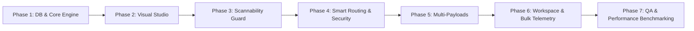

# 📋 SmartQR Engineering Task Roadmap (TASK.md)

> **Document Version:** 2.0.0  
> **Status:** Ready for Implementation  
> **Linked Specification:** [FEATURE.md](file:///c:/Project/test_projects/SmartQR-Management/FEATURE.md)

---

## 🧭 Milestone Overview & Execution Phases

---

## 🔨 Phase 1: Core Engine, Schema Extension & Async Foundation

### `TASK-101`: Database Schema Migration & New Tables
- [x] **Objective**: Extend SQLite database schema to support folders, brand kits, multi-rule routing, and new QR attributes.
- [x] **Affected Files**:
  - [`backend/database.py`](file:///c:/Project/test_projects/SmartQR-Management/backend/database.py)
  - [`backend/models.py`](file:///c:/Project/test_projects/SmartQR-Management/backend/models.py)
- [x] **Acceptance Criteria**:
  - Add tables: `folders`, `brand_kits`, `routing_rules`.
  - Add columns to `qrcodes`: `folder_id`, `eye_frame`, `eye_ball`, `eye_color`, `frame_style`, `frame_text`, `frame_color`, `password_hash`, `scan_limit`, `expires_at`.
  - Add columns to `scan_logs`: `ip_hash`, `country`, `city`, `os_name`, `browser_name`.
  - Backward compatible: Existing QR records load without errors.

### `TASK-102`: Zero-Latency Asynchronous Telemetry Logging
- [x] **Objective**: Ensure dynamic redirect `/r/{short_code}` returns HTTP 307 immediately without waiting for database writes or User-Agent parsing.
- [x] **Affected Files**:
  - [`backend/app.py`](file:///c:/Project/test_projects/SmartQR-Management/backend/app.py)
  - [`backend/database.py`](file:///c:/Project/test_projects/SmartQR-Management/backend/database.py)
- [x] **Acceptance Criteria**:
  - Use FastAPI's `BackgroundTasks` to offload `record_scan_event`.
  - Hash client IP with daily salt (`SHA256`) to calculate Unique Scans without storing raw PII.
  - Redirect endpoint response latency benchmarked under 50ms locally.

### `TASK-103`: Unrestricted Vector & Print Exports (PDF & Transparent SVG/PNG)
- [x] **Objective**: Add print-ready PDF export and support transparent background rendering for PNG and SVG.
- [x] **Affected Files**:
  - [`backend/qr_service.py`](file:///c:/Project/test_projects/SmartQR-Management/backend/qr_service.py)
  - [`backend/app.py`](file:///c:/Project/test_projects/SmartQR-Management/backend/app.py)
  - [`requirements.txt`](file:///c:/Project/test_projects/SmartQR-Management/requirements.txt)
- [x] **Acceptance Criteria**:
  - Endpoint `GET /api/qr/{id}/download/pdf` generates high-resolution print PDF with optional crop/bleed markers.
  - If `bg_color == "transparent"` or `#00000000`, generate PNG/SVG with native alpha channel.

---

## 🎨 Phase 2: Module A — Next-Level Visual Customization Studio

### `TASK-201`: Granular Pattern Control (Classy, Dots, Liquid, Rounded, Square)
- [x] **Objective**: Extend QR module drawers to support custom internal shapes (Square, Rounded, Dots, Classy diamond, Liquid organic).
- [x] **Affected Files**:
  - [`backend/qr_service.py`](file:///c:/Project/test_projects/SmartQR-Management/backend/qr_service.py)
  - [`frontend/js/app.js`](file:///c:/Project/test_projects/SmartQR-Management/frontend/js/app.js)
  - [`frontend/index.html`](file:///c:/Project/test_projects/SmartQR-Management/frontend/index.html)
- [x] **Acceptance Criteria**:
  - Implement custom Pillow module drawer or styled pil drawers for `classy` (diamond/gem) and `liquid` (interconnected rounded pill modules).
  - Frontend UI buttons reflect each pattern option with live real-time preview updates.

### `TASK-202`: Custom Finder Patterns (Corner Eyes) Customization
- [x] **Objective**: Allow independent control over corner eye outer frames (Square, Rounded, Circle, Leaf) and inner balls (Square, Circle, Diamond, Leaf) with custom tinting.
- [x] **Affected Files**:
  - [`backend/qr_service.py`](file:///c:/Project/test_projects/SmartQR-Management/backend/qr_service.py)
  - [`frontend/index.html`](file:///c:/Project/test_projects/SmartQR-Management/frontend/index.html)
  - [`frontend/js/app.js`](file:///c:/Project/test_projects/SmartQR-Management/frontend/js/app.js)
- [x] **Acceptance Criteria**:
  - Eye locations (Top-Left, Top-Right, Bottom-Left) rendered with selected frame/ball geometries.
  - Dedicated color picker for eyes (can match body or use a custom accent color).

### `TASK-203`: Smart Logo Integration with Clean Clearance Zone
- [x] **Objective**: Provide automatic padding and exclusion zone around uploaded logos so modules never bleed into the badge.
- [x] **Affected Files**:
  - [`backend/qr_service.py`](file:///c:/Project/test_projects/SmartQR-Management/backend/qr_service.py)
  - [`frontend/js/app.js`](file:///c:/Project/test_projects/SmartQR-Management/frontend/js/app.js)
- [x] **Acceptance Criteria**:
  - Automatic circular or squircle buffer mask clearing underlying QR dots.
  - Support drag-and-drop file upload for PNG, JPG, SVG with instant client-side preview.
  - Preset icons: WhatsApp, Wi-Fi, Globe, Star, LinkedIn, Instagram, Maps.

### `TASK-204`: Pre-built Frames & Call-to-Action (CTA) Badges
- [x] **Objective**: Render customizable frames around the QR code with call-to-action text labels.
- [x] **Affected Files**:
  - [`backend/qr_service.py`](file:///c:/Project/test_projects/SmartQR-Management/backend/qr_service.py)
  - [`frontend/index.html`](file:///c:/Project/test_projects/SmartQR-Management/frontend/index.html)
  - [`frontend/js/app.js`](file:///c:/Project/test_projects/SmartQR-Management/frontend/js/app.js)
- [x] **Acceptance Criteria**:
  - Frame templates: Bottom Banner ("Scan for Menu", "Scan Me", "Connect Wi-Fi"), Top Banner, Ticket/Stamp border.
  - Customizable text label, font color, and frame background color.

### `TASK-205`: Brand Kit Presets
- [x] **Objective**: Allow users to save their customized palette, eye shapes, and logo as a reusable Brand Kit.
- [x] **Affected Files**:
  - [`backend/app.py`](file:///c:/Project/test_projects/SmartQR-Management/backend/app.py)
  - [`backend/database.py`](file:///c:/Project/test_projects/SmartQR-Management/backend/database.py)
  - [`frontend/index.html`](file:///c:/Project/test_projects/SmartQR-Management/frontend/index.html)
  - [`frontend/js/app.js`](file:///c:/Project/test_projects/SmartQR-Management/frontend/js/app.js)
- [x] **Acceptance Criteria**:
  - API endpoints: `GET /api/brand-kits`, `POST /api/brand-kits`, `DELETE /api/brand-kits/{id}`.
  - UI dropdown to switch Brand Kits and apply all design rules with 1-click.

---

## 🛡️ Phase 3: Module B — Real-Time Scannability Guard

### `TASK-301`: Live Color Contrast Checker (WCAG Standard)
- [x] **Objective**: Compute real-time luminance contrast ratio between foreground and background colors and warn of unscannable combinations.
- [x] **Affected Files**:
  - [`frontend/js/app.js`](file:///c:/Project/test_projects/SmartQR-Management/frontend/js/app.js)
  - [`frontend/css/style.css`](file:///c:/Project/test_projects/SmartQR-Management/frontend/css/style.css)
- [x] **Acceptance Criteria**:
  - Calculate photometric relative luminance for both colors.
  - If ratio < 4.0:1, display a visible amber/red warning toast: *"Low Contrast: Camera scanners may struggle to detect this QR."*
  - Add an "Auto-Fix Contrast" button that suggests an optimal high-contrast pair.

### `TASK-302`: Automatic Error-Correction Escalation
- [x] **Objective**: Prevent unscannable QRs by automatically enforcing high error recovery when heavy styling or logos are present.
- [x] **Affected Files**:
  - [`backend/qr_service.py`](file:///c:/Project/test_projects/SmartQR-Management/backend/qr_service.py)
  - [`frontend/js/app.js`](file:///c:/Project/test_projects/SmartQR-Management/frontend/js/app.js)
- [x] **Acceptance Criteria**:
  - When a center logo is uploaded or selected, UI automatically shifts and locks Error Correction to Level `H` (30%).
  - Backend enforces minimum Level `H` if `logo_type != 'none'`.

### `TASK-303`: Interactive Scanner Readiness Score Widget
- [x] **Objective**: Display an interactive live score badge (0–100%) showing camera scannability confidence.
- [x] **Affected Files**:
  - [`frontend/index.html`](file:///c:/Project/test_projects/SmartQR-Management/frontend/index.html)
  - [`frontend/js/app.js`](file:///c:/Project/test_projects/SmartQR-Management/frontend/js/app.js)
  - [`frontend/css/style.css`](file:///c:/Project/test_projects/SmartQR-Management/frontend/css/style.css)
- [x] **Acceptance Criteria**:
  - Live progress meter: `95% - Excellent`, `75% - Moderate`, `< 60% - Needs Improvement`.
  - Detailed tooltip explaining factors (Contrast, EC redundancy, Logo ratio, Quiet zone).

---

## ⚡ Phase 4: Module C — Dynamic QR & Smart Routing Engine

### `TASK-401`: Device / OS-Based Smart Routing
- [x] **Objective**: Enable redirect engine to route users to different destinations based on client operating system (iOS, Android, Desktop).
- [x] **Affected Files**:
  - [`backend/app.py`](file:///c:/Project/test_projects/SmartQR-Management/backend/app.py)
  - [`backend/database.py`](file:///c:/Project/test_projects/SmartQR-Management/backend/database.py)
  - [`frontend/index.html`](file:///c:/Project/test_projects/SmartQR-Management/frontend/index.html)
  - [`frontend/js/app.js`](file:///c:/Project/test_projects/SmartQR-Management/frontend/js/app.js)
- [x] **Acceptance Criteria**:
  - QR details modal allows configuring: iOS URL (App Store), Android URL (Play Store), Desktop URL.
  - `GET /r/{short_code}` inspects `User-Agent` and seamlessly redirects accordingly.

### `TASK-402`: Time-Based Scheduling & Dayparting
- [x] **Objective**: Support time-based URL switching (e.g. Breakfast Menu 07:00-11:00 vs. Dinner Menu 18:00-23:00) and promotional date windows.
- [x] **Affected Files**:
  - [`backend/app.py`](file:///c:/Project/test_projects/SmartQR-Management/backend/app.py)
  - [`backend/database.py`](file:///c:/Project/test_projects/SmartQR-Management/backend/database.py)
  - [`frontend/index.html`](file:///c:/Project/test_projects/SmartQR-Management/frontend/index.html)
- [x] **Acceptance Criteria**:
  - Support configuring start/end hour of day and start/end calendar dates.
  - Correct destination served when scanning at configured hour.

### `TASK-403`: Security & Access Control (Password Gate, Limits, Expiry)
- [x] **Objective**: Implement password-protected access, max scan limits, and hard expiration dates for sensitive QRs.
- [x] **Affected Files**:
  - [`backend/app.py`](file:///c:/Project/test_projects/SmartQR-Management/backend/app.py)
  - [`backend/database.py`](file:///c:/Project/test_projects/SmartQR-Management/backend/database.py)
- [x] **Acceptance Criteria**:
  - Password Gate: Scan redirects to a clean PIN/Password prompt page. Entering correct PIN redirects to destination.
  - Scan Limit: If `scan_count >= scan_limit`, redirect to "Campaign Ended / Limit Reached" screen.
  - Expiry Date: If current time > `expires_at`, redirect to "QR Code Expired" screen.

---

## 📱 Phase 5: Module D — Multi-Payload Generator Engine

### `TASK-501`: vCard Plus (Digital Business Card)
- [x] **Objective**: Support creation of interactive digital business cards with direct `.vcf` download.
- [x] **Affected Files**:
  - [`backend/app.py`](file:///c:/Project/test_projects/SmartQR-Management/backend/app.py)
  - [`frontend/index.html`](file:///c:/Project/test_projects/SmartQR-Management/frontend/index.html)
  - [`frontend/js/app.js`](file:///c:/Project/test_projects/SmartQR-Management/frontend/js/app.js)
- [x] **Acceptance Criteria**:
  - vCard builder form: Name, Phone, Email, Company, Job Title, Social links.
  - Hosted mobile view (`/v/{short_code}`) with modern card UI and 1-click "Add to Contacts" (`.vcf` download).

### `TASK-502`: Direct Wi-Fi Connect Generator
- [x] **Objective**: Generate standard Wi-Fi configuration QRs for instant phone connection.
- [x] **Affected Files**:
  - [`frontend/index.html`](file:///c:/Project/test_projects/SmartQR-Management/frontend/index.html)
  - [`frontend/js/app.js`](file:///c:/Project/test_projects/SmartQR-Management/frontend/js/app.js)
- [x] **Acceptance Criteria**:
  - Inputs for SSID, Password, Encryption (WPA/WPA2/WPA3, WEP, None), and Hidden flag.
  - Encodes valid `WIFI:T:...;S:...;P:...;;` string recognized by iOS and Android camera apps.

### `TASK-503`: Pre-filled Action Triggers (WhatsApp, Email, SMS, Maps)
- [x] **Objective**: Provide structured forms for quick action triggers.
- [x] **Affected Files**:
  - [`frontend/index.html`](file:///c:/Project/test_projects/SmartQR-Management/frontend/index.html)
  - [`frontend/js/app.js`](file:///c:/Project/test_projects/SmartQR-Management/frontend/js/app.js)
- [x] **Acceptance Criteria**:
  - WhatsApp: Country code, phone number, pre-filled message text.
  - Email: Recipient, Subject, Body text.
  - SMS: Phone number and message.
  - Google Maps: Lat/Long or Place query.

### `TASK-504`: App Deep-Linking & Payment Gateway Triggers
- [x] **Objective**: Support direct application URI schemes (Instagram, Facebook, bKash, UPI) with browser fallback.
- [x] **Affected Files**:
  - [`backend/app.py`](file:///c:/Project/test_projects/SmartQR-Management/backend/app.py)
  - [`frontend/js/app.js`](file:///c:/Project/test_projects/SmartQR-Management/frontend/js/app.js)
- [x] **Acceptance Criteria**:
  - Support `fb://`, `instagram://`, `bkash://`, `upi://` schemes with smart web fallback.

---

## 📊 Phase 6: Module E — Business Workspace, Bulk Engine & Telemetry

### `TASK-601`: Folder & Campaign Management
- [x] **Objective**: Allow users to create folders, assign QRs to folders/campaigns, and filter their dashboard.
- [x] **Affected Files**:
  - [`backend/app.py`](file:///c:/Project/test_projects/SmartQR-Management/backend/app.py)
  - [`backend/database.py`](file:///c:/Project/test_projects/SmartQR-Management/backend/database.py)
  - [`frontend/index.html`](file:///c:/Project/test_projects/SmartQR-Management/frontend/index.html)
  - [`frontend/js/app.js`](file:///c:/Project/test_projects/SmartQR-Management/frontend/js/app.js)
- [x] **Acceptance Criteria**:
  - CRUD for folders (`/api/folders`).
  - Sidebar or filter tabs in dashboard to filter QRs by folder or tag.
  - Move QR to folder action in card dropdown.

### `TASK-602`: Bulk QR Code Generation Engine (CSV Upload -> ZIP Export)
- [x] **Objective**: Enable bulk generation of up to 500 QR codes from a single CSV upload, bundled into a `.zip` file.
- [x] **Affected Files**:
  - [`backend/app.py`](file:///c:/Project/test_projects/SmartQR-Management/backend/app.py)
  - [`backend/qr_service.py`](file:///c:/Project/test_projects/SmartQR-Management/backend/qr_service.py)
  - [`frontend/index.html`](file:///c:/Project/test_projects/SmartQR-Management/frontend/index.html)
  - [`frontend/js/app.js`](file:///c:/Project/test_projects/SmartQR-Management/frontend/js/app.js)
- [x] **Acceptance Criteria**:
  - Upload CSV with `title,target_url`.
  - Batch worker applies current visual styling, generates all QRs, and returns a `.zip` archive containing `{id}_{title}.png` files and a summary CSV.

### `TASK-603`: Advanced Audience Insights Dashboard & Telemetry Charts
- [x] **Objective**: Build telemetry visualizations showing geographic breakdowns, peak hours, and device families.
- [x] **Affected Files**:
  - [`backend/database.py`](file:///c:/Project/test_projects/SmartQR-Management/backend/database.py)
  - [`backend/app.py`](file:///c:/Project/test_projects/SmartQR-Management/backend/app.py)
  - [`frontend/index.html`](file:///c:/Project/test_projects/SmartQR-Management/frontend/index.html)
  - [`frontend/js/app.js`](file:///c:/Project/test_projects/SmartQR-Management/frontend/js/app.js)
- [x] **Acceptance Criteria**:
  - Analytics modal upgraded with:
    - Unique Scans vs. Total Scans metric.
    - 24-hour time heatmap (hourly scan breakdown).
    - Top Countries and Cities list.
    - OS breakdown chart (iOS, Android, Windows, Mac).

---

## 🧪 Phase 7: Verification, Performance Benchmarking & Hardening

### `TASK-701`: Automated Unit & Integration Tests
- [ ] **Objective**: Write comprehensive test suite for QR generation, routing rules, and analytics logging.
- [ ] **Affected Files**:
  - `tests/test_api.py`
  - `tests/test_qr_engine.py`
- [ ] **Acceptance Criteria**:
  - Test dynamic redirect status code 307.
  - Test OS-based user-agent redirection.
  - Test password validation and expiry limits.
  - Test image and SVG generation without memory leaks.

### `TASK-702`: Redirect Latency Benchmarking (<50ms)
- [ ] **Objective**: Benchmark local redirect route under simulated concurrency.
- [ ] **Affected Files**:
  - `backend/app.py`
- [ ] **Acceptance Criteria**:
  - Verify TTFB is under 50ms locally for `/r/{short_code}`.
  - Verify background scan logging does not block HTTP response.

---

## 📌 Implementation Checklist Summary

| Phase | Milestone | Primary Focus | Status |
|:---:|:---|:---|:---:|
| **Phase 1** | Core & Async Engine | Schema migration, Async scan logging, PDF/Vector export | ✅ Completed |
| **Phase 2** | Visual Customization | Granular patterns, Finder eyes, Smart logo, CTA frames, Brand kit | ✅ Completed |
| **Phase 3** | Scannability Guard | Contrast checker, Auto error correction, Readiness score | ✅ Completed |
| **Phase 4** | Smart Routing & Security | Device/OS routing, Time-based routing, Password/Expiry gates | ✅ Completed |
| **Phase 5** | Multi-Payload Generators | vCard Plus, Wi-Fi, Pre-filled actions, App deep-linking | ✅ Completed |
| **Phase 6** | Workspace & Bulk Telemetry | Folders, Bulk CSV -> ZIP generator, Audience analytics | ✅ Completed |
| **Frontend** | Modern Next.js 14 App | Linear/Vercel Dark-Luxe UI, Live Studio, Manager, Analytics | ✅ Completed |
| **Phase 7** | Quality Assurance | Latency benchmarking, Unit tests, Documentation | ⏳ Pending |

---

## ⚛️ Modern Next.js Frontend Architecture & Tasks (App Router)

### `TASK-FE-01`: Next.js 14+ App Router & Design System Setup
- [ ] **Objective**: Initialize Next.js app with TypeScript, Tailwind CSS, Lucide React, Shadcn/Radix UI, and Framer Motion.
- [ ] **Libraries & Stack**:
  - `next`: 14+ App Router (React Server & Client Components)
  - `tailwindcss`: Refined dark-luxe slate palette & micro-grid backdrop tokens
  - `lucide-react`: Sharp, minimalist modern vector icons
  - `framer-motion`: Fluid spring animations & layout transitions
  - `zustand`: High-performance reactive studio state store
  - `@tanstack/react-query`: Automatic server synchronization, caching, and optimistic UI updates
  - `sonner`: Clean stacked toast notifications
  - `colord`: WCAG 2.1 relative luminance & contrast calculations

### `TASK-FE-02`: Studio Customization Engine Components
- [ ] **Objective**: Implement modern interactive React components for QR styling:
  - `PatternSelector.tsx`: Granular module geometry (Rounded, Circle, Gem, Liquid, Gapped, Square)
  - `EyeSelector.tsx`: Corner eye outer frame & inner ball shapes with custom color tinting
  - `ColorEngine.tsx`: Solid, Linear, and Radial gradients with transparent alpha background support
  - `LogoUploader.tsx`: Center logo upload with automatic padding clearance & brand icon presets
  - `CtaFrameCustom.tsx`: Top & Bottom CTA banner frames with customizable labels & colors
  - `SecurityOptions.tsx`: PIN password gate, max scan limit, and hard expiry datetime picker
  - `BrandKitBar.tsx`: 1-click theme application & corporate brand kit save modal

### `TASK-FE-03`: Real-Time Holographic Preview & Scannability Guard
- [ ] **Objective**: Implement reactive live preview card and WCAG scannability guard widget:
  - `LivePreviewCard.tsx`: Sticky responsive hologram preview with debounced backend rendering
  - `ScannabilityGuard.tsx`: Real-time WCAG contrast meter, 0–100% score badge & 1-click Auto-Fix button
  - `ExportBar.tsx`: PNG (800/1200/2400px), SVG vector, and 300 DPI print PDF export buttons

### `TASK-FE-04`: Workspace Manager & Smart Rules Modals
- [ ] **Objective**: Implement dashboard management and smart routing dialogs:
  - `QrGrid.tsx` & `QrCard.tsx`: Filterable QR card listing with status pills (PIN, Exp, Limits, Rules)
  - `RulesModal.tsx`: Tabbed modal for OS-based smart routing, time dayparting schedules & access security
  - `AnalyticsModal.tsx`: Recharts device breakdown charts & recent scan logs table
